# Dokumentacja projektu: Sudoku Web

## Spis treści

1. Wymagania
2. Przypadki użycia
3. Diagramy aktywności
4. Diagramy sekwencji
5. Diagramy klas
6. Diagram ERD
7. Specyfikacja API
8. Architektura i testy

---

## 1. Wymagania

### Funkcjonalne

| ID | Wymaganie |
|---|---|
| F1 | System generuje planszę Sudoku w trzech poziomach trudności. |
| F2 | Gracz może wpisać cyfrę 1-9 w pustym polu; pola początkowe są zablokowane. |
| F3 | System wykrywa i podświetla konflikty (powtórzenia w wierszu, kolumnie, bloku 3x3). |
| F4 | Gracz może korzystać z notatek, cofania/ponawiania i podpowiedzi. |
| F5 | System mierzy czas gry i pozwala go zatrzymać. |
| F6 | Zalogowany gracz może zapisać i wznowić grę. |
| F7 | Po poprawnym rozwiązaniu wynik trafia do rankingu. |
| F8 | Administrator może przeglądać i usuwać wyniki oraz zarządzać zbiorem plansz. |

### Niefunkcjonalne

| ID | Wymaganie |
|---|---|
| N1 | Działanie w aktualnych wersjach Chrome, Firefox, Safari, Edge. |
| N2 | Generowanie planszy poniżej 1 s. |
| N3 | Interfejs responsywny (desktop i telefon). |
| N4 | Hasła przechowywane jako hash (bcrypt), komunikacja przez HTTPS. |
| N5 | Pokrycie testami logiki domenowej minimum 80%. |

---

## 2. Przypadki użycia

### Diagram przypadków użycia

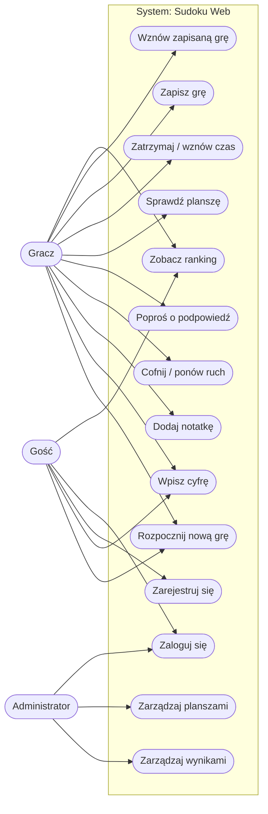

Gracz dziedziczy możliwości gościa (po zalogowaniu). Gość może grać, ale jego wyniki i postęp nie są zapisywane.

### Scenariusze (opisy tekstowe)

**UC1: Rozpocznij nową grę**

| Pole | Opis |
|---|---|
| Aktor | Gość, Gracz |
| Warunek wstępny | Aplikacja jest załadowana. |
| Scenariusz główny | 1. Użytkownik wybiera poziom trudności. 2. System pobiera/generuje planszę. 3. System wyświetla planszę i uruchamia licznik czasu. |
| Scenariusz alternatywny | 2a. Błąd serwera: system generuje planszę lokalnie w przeglądarce. |
| Warunek końcowy | Gra jest w stanie `W_TRAKCIE`. |

**UC2: Wpisz cyfrę**

| Pole | Opis |
|---|---|
| Aktor | Gość, Gracz |
| Warunek wstępny | Gra jest w trakcie, wybrane pole jest puste (nie jest polem początkowym). |
| Scenariusz główny | 1. Użytkownik zaznacza pole. 2. Wpisuje cyfrę 1-9. 3. System zapisuje ruch i sprawdza konflikty. 4. System aktualizuje widok. |
| Scenariusz alternatywny | 2a. Użytkownik wpisuje cyfrę w polu początkowym: system ignoruje akcję. 3a. Wykryto konflikt: system podświetla pola w konflikcie. 3b. Plansza kompletna i poprawna: przejście do UC "Zakończ grę" (zapis wyniku). |
| Warunek końcowy | Stan planszy zawiera nowy ruch. |

**UC10: Zapisz grę**

| Pole | Opis |
|---|---|
| Aktor | Gracz |
| Warunek wstępny | Użytkownik jest zalogowany, gra jest w trakcie. |
| Scenariusz główny | 1. Użytkownik wybiera "Zapisz". 2. System wysyła stan planszy, czas i historię ruchów do API. 3. System potwierdza zapis. |
| Scenariusz alternatywny | 2a. Brak sieci: system zachowuje stan lokalnie i ponawia próbę później. |

**UC12: Zobacz ranking**

| Pole | Opis |
|---|---|
| Aktor | Gość, Gracz |
| Scenariusz główny | 1. Użytkownik otwiera widok rankingu. 2. Wybiera poziom trudności. 3. System wyświetla 10 najlepszych czasów. |

---

## 3. Diagramy aktywności

### 3.1. Rozgrywka (od startu do zakończenia)

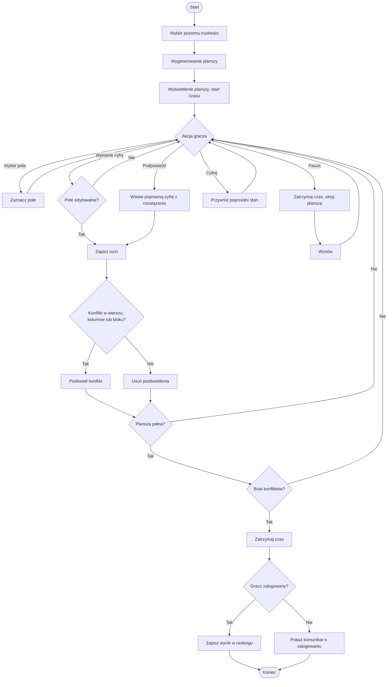

### 3.2. Generowanie planszy

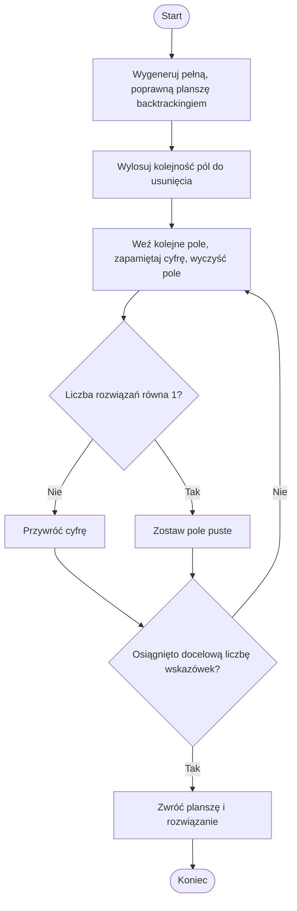

Docelowa liczba wskazówek: łatwy ~40, średni ~32, trudny ~26.

---

## 4. Diagramy sekwencji

### 4.1. Nowa gra

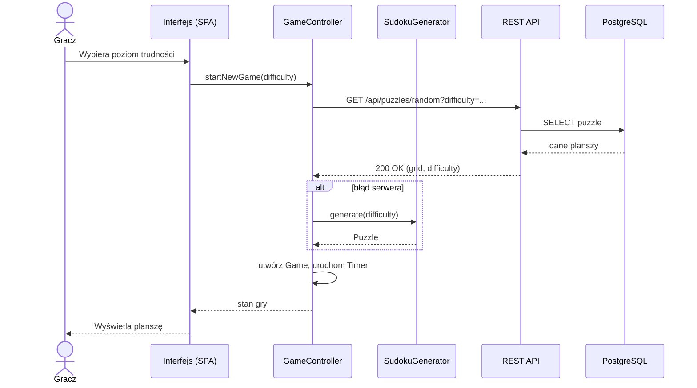

### 4.2. Wpisanie cyfry i zakończenie gry

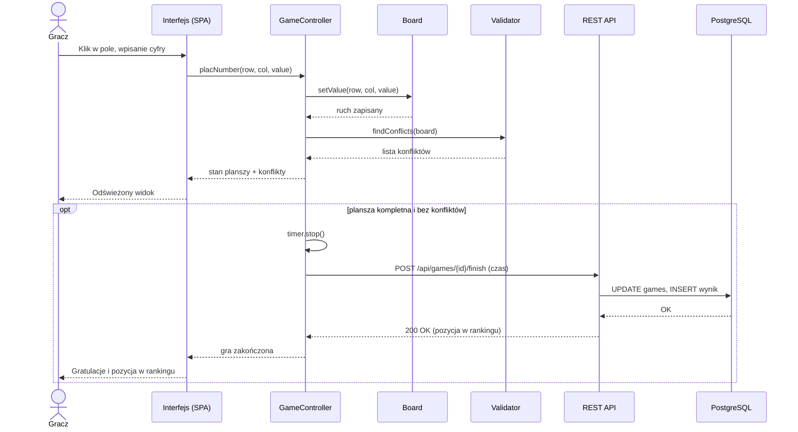

### 4.3. Logowanie

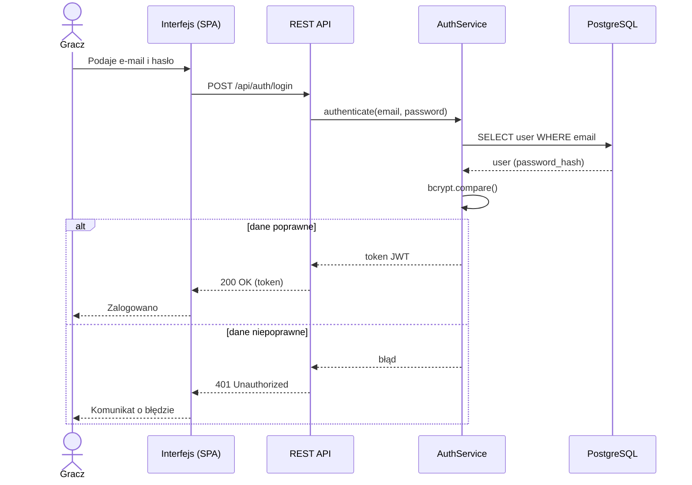

### 4.4. Zapis i wznowienie gry

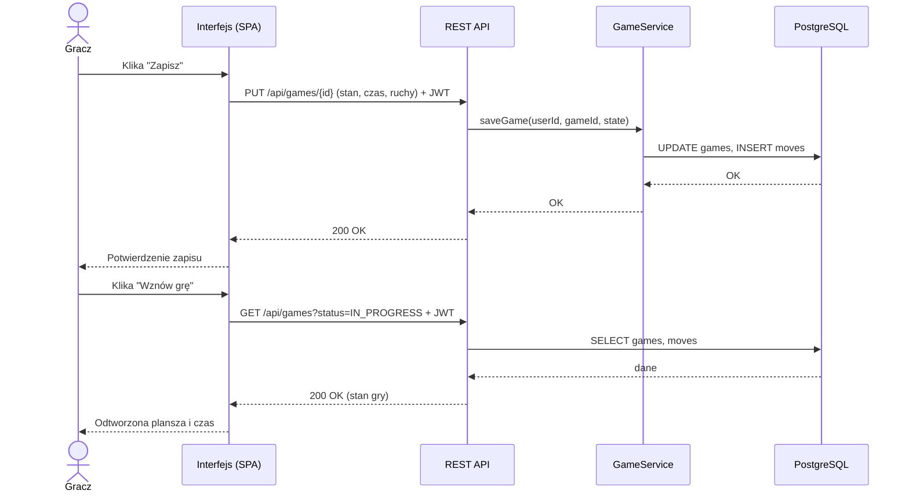

---

## 5. Diagramy klas

### 5.1. Logika domenowa (frontend)

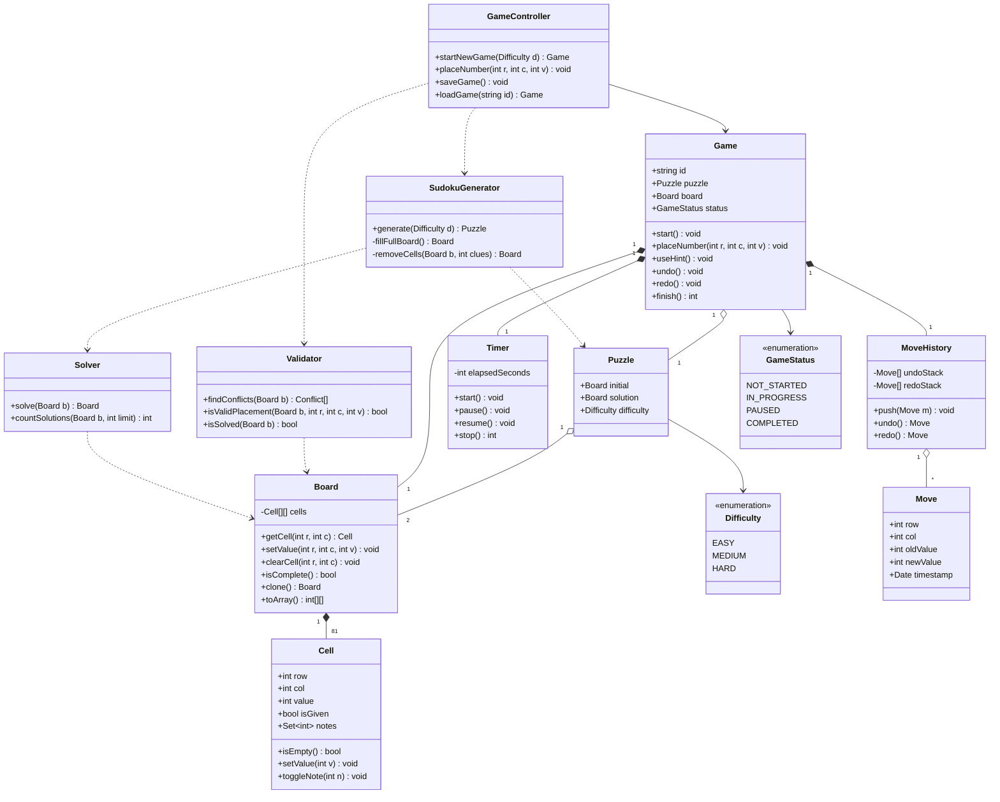

### 5.2. Warstwa backendu

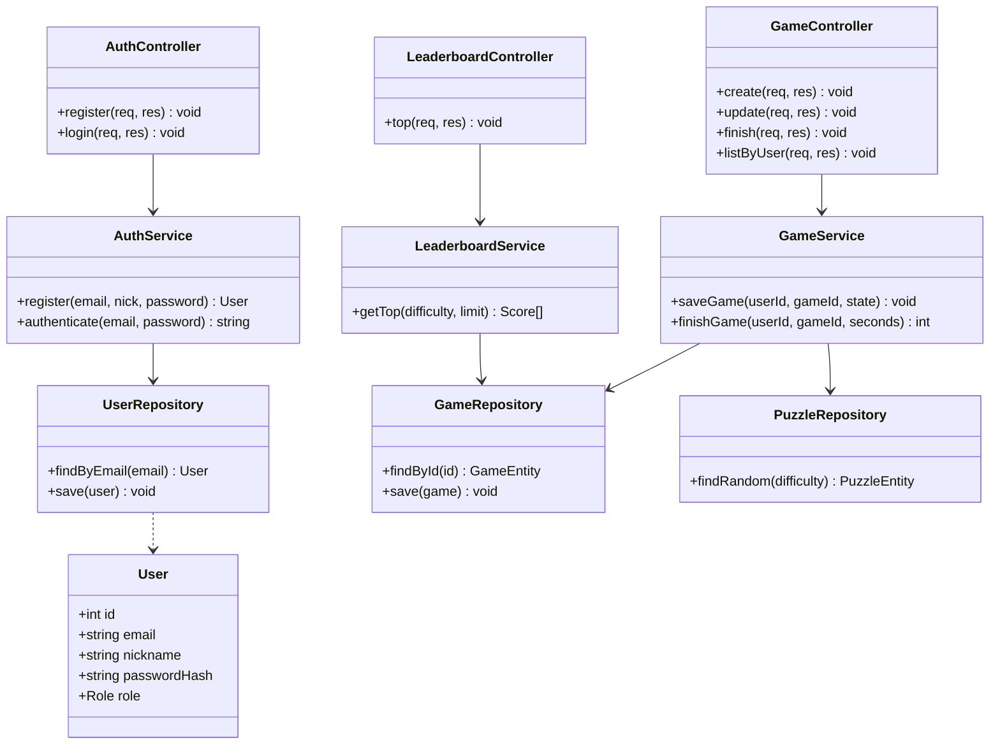

---

## 6. Diagram ERD

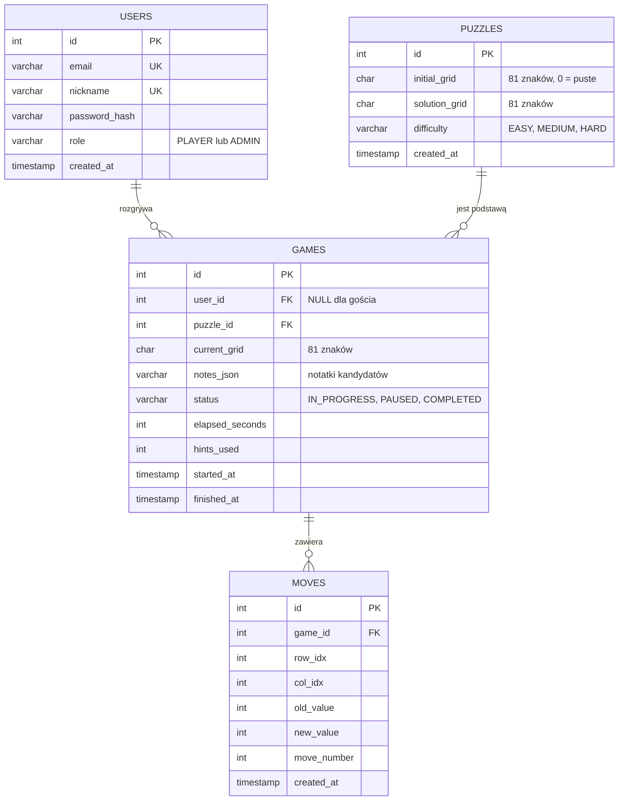

### Schemat SQL (`db/schema.sql`)

```sql
CREATE TABLE users (
    id            SERIAL PRIMARY KEY,
    email         VARCHAR(255) NOT NULL UNIQUE,
    nickname      VARCHAR(50)  NOT NULL UNIQUE,
    password_hash VARCHAR(255) NOT NULL,
    role          VARCHAR(10)  NOT NULL DEFAULT 'PLAYER',
    created_at    TIMESTAMP    NOT NULL DEFAULT NOW()
);

CREATE TABLE puzzles (
    id            SERIAL PRIMARY KEY,
    initial_grid  CHAR(81)    NOT NULL,
    solution_grid CHAR(81)    NOT NULL,
    difficulty    VARCHAR(10) NOT NULL CHECK (difficulty IN ('EASY','MEDIUM','HARD')),
    created_at    TIMESTAMP   NOT NULL DEFAULT NOW()
);

CREATE TABLE games (
    id              SERIAL PRIMARY KEY,
    user_id         INT REFERENCES users(id) ON DELETE CASCADE,
    puzzle_id       INT NOT NULL REFERENCES puzzles(id),
    current_grid    CHAR(81) NOT NULL,
    notes_json      TEXT,
    status          VARCHAR(12) NOT NULL DEFAULT 'IN_PROGRESS',
    elapsed_seconds INT NOT NULL DEFAULT 0,
    hints_used      INT NOT NULL DEFAULT 0,
    started_at      TIMESTAMP NOT NULL DEFAULT NOW(),
    finished_at     TIMESTAMP
);

CREATE TABLE moves (
    id          SERIAL PRIMARY KEY,
    game_id     INT NOT NULL REFERENCES games(id) ON DELETE CASCADE,
    row_idx     SMALLINT NOT NULL CHECK (row_idx BETWEEN 0 AND 8),
    col_idx     SMALLINT NOT NULL CHECK (col_idx BETWEEN 0 AND 8),
    old_value   SMALLINT NOT NULL DEFAULT 0,
    new_value   SMALLINT NOT NULL DEFAULT 0,
    move_number INT NOT NULL,
    created_at  TIMESTAMP NOT NULL DEFAULT NOW()
);

CREATE INDEX idx_games_user ON games(user_id);
CREATE INDEX idx_games_ranking ON games(status, elapsed_seconds);
CREATE INDEX idx_moves_game ON moves(game_id);
```

Ranking nie ma osobnej tabeli. Jest widokiem na `games` ze statusem `COMPLETED`, posortowanym po `elapsed_seconds` (osobno dla każdego poziomu trudności).

---

## 7. Specyfikacja API

| Metoda | Endpoint | Opis | Auth |
|---|---|---|---|
| POST | `/api/auth/register` | Rejestracja | nie |
| POST | `/api/auth/login` | Logowanie, zwraca JWT | nie |
| GET | `/api/puzzles/random?difficulty=EASY` | Losowa plansza | nie |
| POST | `/api/games` | Utworzenie gry | tak |
| GET | `/api/games?status=IN_PROGRESS` | Gry użytkownika | tak |
| PUT | `/api/games/{id}` | Zapis stanu gry | tak |
| POST | `/api/games/{id}/finish` | Zakończenie, wynik do rankingu | tak |
| GET | `/api/leaderboard?difficulty=HARD&limit=10` | Ranking | nie |
| DELETE | `/api/admin/games/{id}` | Usunięcie wyniku | admin |

Przykład odpowiedzi `GET /api/puzzles/random?difficulty=EASY`:

```json
{
  "id": 17,
  "difficulty": "EASY",
  "grid": "530070000600195000098000060800060003400803001700020006060000280000419005000080079"
}
```

---

## 8. Architektura i testy

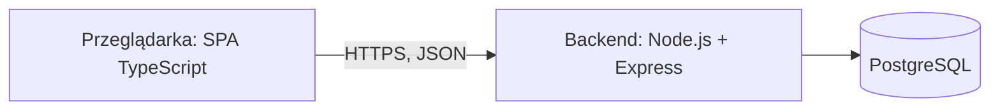

**Strategia testów**

| Poziom | Zakres | Narzędzie |
|---|---|---|
| Jednostkowe | Validator, Solver, Generator, MoveHistory | Vitest |
| Integracyjne | Endpointy API z testową bazą | Vitest + Supertest |
| End-to-end | Rozegranie gry, logowanie, zapis | Playwright |

**CI (GitHub Actions):** instalacja, lint, testy jednostkowe i integracyjne, build frontendu przy każdym Pull Requeście.

**Rozwój w przyszłości:** tryb dzienny (ta sama plansza dla wszystkich), warianty (Killer, Samurai), tryb offline (PWA).
